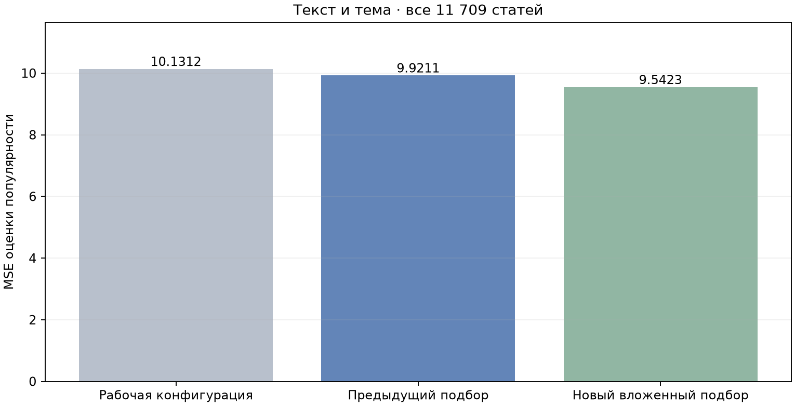
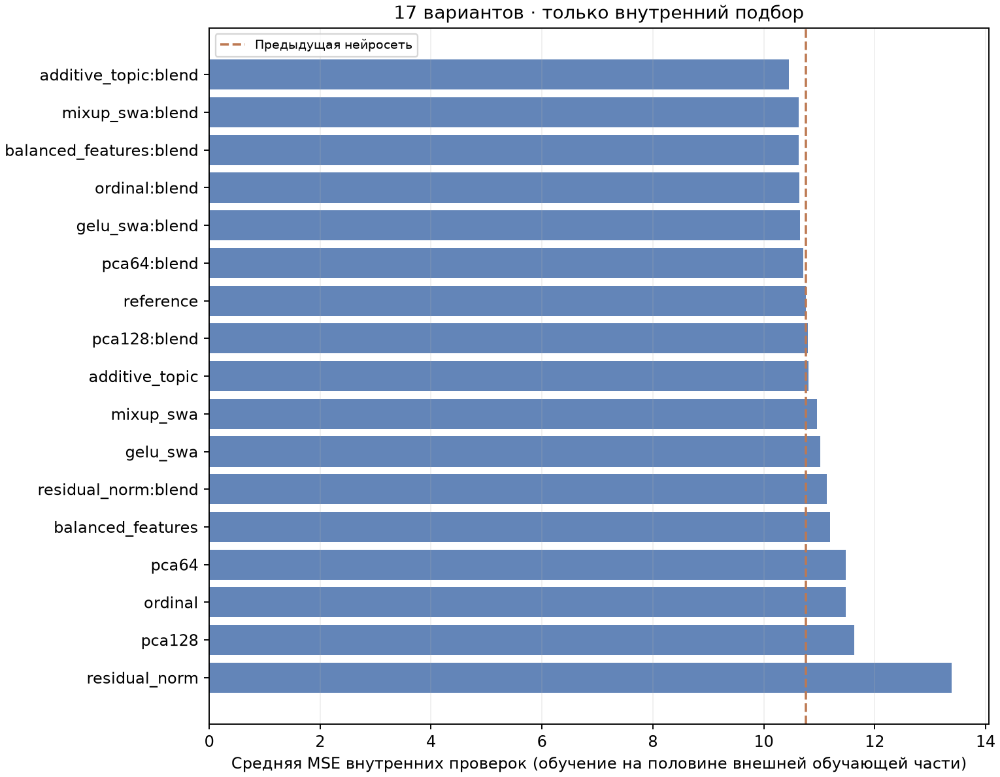
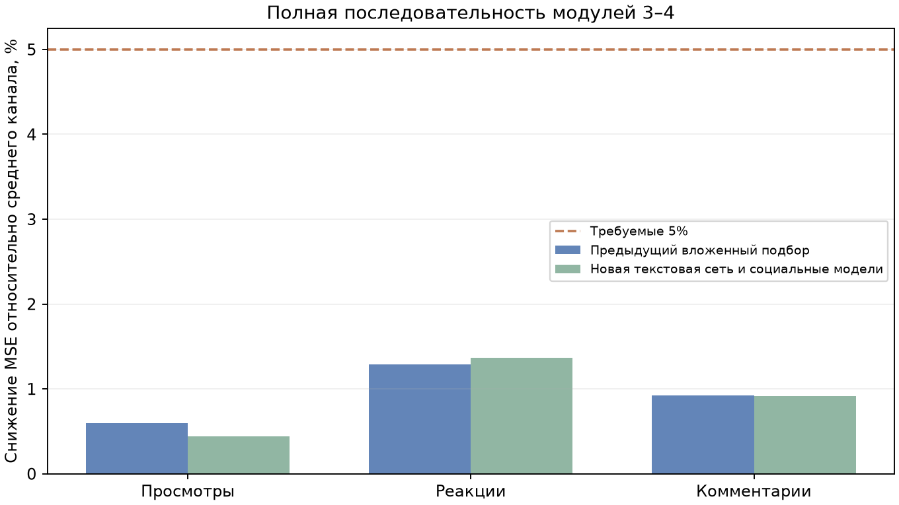

# Расширенный подбор нейросетей и проверка последовательности модулей

**До изменения рабочих весов выполнена полная проверка.** В этом запуске проверены все **11 709 статей**, **11 549 групп нормализованных текстов**, **146 ресурсов**. Текущая рабочая пара и БД не изменены.

## Текстовая модель

MSE рабочей конфигурации на всех статьях — **10.1312**; предыдущего подбора — **9.9211**; нового — **9.5423**. Снижение составляет **5.81%** относительно рабочей конфигурации и **3.82%** относительно предыдущего подбора. 95% парный bootstrap-интервал последнего улучшения по каналам (3000 повторов): **[2.36%; 5.29%]**. В рамках этого повторно используемого корпуса интервал не включает ноль; новый временной контроль всё равно нужен.



Восемь новых архитектур/режимов и их равные смеси с предыдущим нейросетевым ансамблем дают 17 вариантов с учётом исходного ансамбля. Проверены GELU, cosine learning rate, усреднение весов последних 25% эпох, mixup, остаточные связи с LayerNorm, PCA текста на 64/128 компонент, отдельная линейная ветка темы, порядковая регрессия по 21 уровню и центрирование признаков без стандартизации дисперсий. Масштабирование и PCA обучаются только на обучающих строках. Входы остаются **текст и эмбеддинг темы**; канал в текстовую модель не передаётся.

| Внешняя часть | Выбор по внутренней проверке | MSE нового варианта | MSE предыдущего |
| --- | --- | ---: | ---: |
| 1 | additive_topic:blend | 9.2640 | 9.6539 |
| 2 | additive_topic:blend | 9.9597 | 10.2871 |
| 3 | additive_topic:blend | 9.7438 | 10.1329 |
| 4 | additive_topic:blend | 9.7072 | 10.0236 |
| 5 | additive_topic:blend | 9.0341 | 9.5052 |

`additive_topic`: текстовая ветка 384 → 256 → 128 → 1, GELU, Dropout 0,5; тема проходит отдельный линейный слой 384 → 1, результаты складываются перед `10*tanh`. AdamW, начальный learning rate 0,0005, weight decay 0,2, batch 128, 35 эпох с cosine-расписанием и усреднением последних эпох. `:blend` означает вес 0,5 у этой сети и по 0,25 у двух сетей предыдущего варианта (768 → 512 → 128 → 1, Dropout 0,65, разные seed). Это исследовательский ансамбль, сохранённый отдельно от приложения.

График ниже отражает только внутренний выбор; его MSE не заменяет результат полной внешней проверки выше.



## Прогноз социальных метрик

Для каждого внешнего разбиения выбранная текстовая конфигурация заново обучена в трёх OOF-разбиениях обучающей части. По этим прогнозам, а не по истинной оценке из метрик, отдельно подбираются модели просмотров, реакций и комментариев. Проверочная текстовая оценка получена сетью, обученной только на внешней обучающей части.

Проверено **126 конфигураций**: история канала, тема, локальный наклон по оценке, независимая ridge-регрессия и новый сглаженный поиск соседей по оценке/теме внутри ресурса. Для нового варианта подбираются ширина гауссова ядра, усиление совпадающей темы, сглаживание к среднему и обучающее ограничение хвоста. Исходные проверочные количества не обрезаются и не удаляются. Среднее канала рассчитано на той же обучающей части с нормировкой на аудиторию.

| Метрика | MSE среднего | MSE модели | Снижение MSE | Требование 5% |
| --- | ---: | ---: | ---: | --- |
| Просмотры | 14540292.88 | 14476660.48 | +0.44% | нет |
| Реакции | 2281769.90 | 2250507.96 | +1.37% | нет |
| Комментарии | 2265.21 | 2244.46 | +0.92% | нет |



**Порог снижения MSE на 5% отдельно для каждой социальной метрики не пройден. Рабочая пара не заменена.**

## Время ответа

Через отдельное локальное ASGI-приложение проверены все пять исследовательских пар: по 12 реальных текстов разной длины и текст на 50 000 символов. Максимум для реальных текстов — **0.584 с**, для 50 000 символов — **5.009 с**. Условие 10 секунд выполнено на проверенном оборудовании.

Измерение включает контроллер, полный SBERT текста, автоматическое определение темы, прогноз оценки, три социальных прогноза и JSON. Не включает первую загрузку, БД, сеть или рекомендации LLM. Время обучения в выборе не участвовало.

## Протокол и ограничения

Каждая статья имеет ровно один внешний проверочный прогноз в пяти GroupKFold-разбиениях с seed 20261111. Совпадающие нормализованные тексты не пересекают границу обучения/проверки. Архитектура выбирается на двух внутренних групповых разбиениях (seed 91). Внешние проверочные ответы исключены из обучения, масштабирования, PCA и выбора параметров. Кэш новых моделей проверяет хеш корпуса, индексы обучения, конфигурацию и seed. Предыдущий нейросетевой ориентир воспроизведён по всем проверочным прогнозам.

Корпус уже использовался в исследованиях: результат описывает повторную проверку доступных данных, а не новый независимый контроль будущих дат. Случайное групповое разбиение не проверяет временной сдвиг. Внутренний подбор социальных моделей повторно использует OOF-оценки внешней обучающей части; внешний тест исключён из всей цепочки. Одна статья со 160 347 реакциями по-прежнему остаётся в проверке.

Прошли 168 Python-тестов и 14 JS-тестов; среди новых проверок — воспроизводимость mixup, сериализация всех архитектур, сохранение состояния генератора случайных чисел, обучающее происхождение кэша и независимость целевых метрик. Дополнительно все 11 709 социальных прогнозов точно воспроизведены после повторной загрузки сохранённых моделей ([проверка](artifact_verification.json)). Контрольные суммы рабочей пары сохранены в [summary.json](summary.json).

## Воспроизведение

```powershell
.\.venv312\Scripts\python.exe -m model_tests.advanced_neural_study --corpus model_tests/results/per_metric_20261111 --previous model_tests/results/text_ensembles_20261111 --output model_tests/results/new_advanced_text
.\.venv312\Scripts\python.exe -m model_tests.advanced_pipeline_study --corpus model_tests/results/per_metric_20261111 --text-study model_tests/results/new_advanced_text --output model_tests/results/new_advanced_pipeline
.\.venv312\Scripts\python.exe -m model_tests.advanced_model_latency --corpus model_tests/results/per_metric_20261111 --text-study model_tests/results/new_advanced_text --social-study model_tests/results/new_advanced_pipeline
```

Нужны локальные снимки предыдущих экспериментов. В публичную копию включены только код и агрегированные отчёты; тексты статей, матрицы, индексы разбиений и промежуточные веса остаются локально.

[Текстовая проверка](text_report.json) · [Социальные метрики](social_report.json) · [Время ответа](latency.json) · [Конфигурации](neural_configurations.csv) · [MSE социальных метрик](social_metrics.csv)
