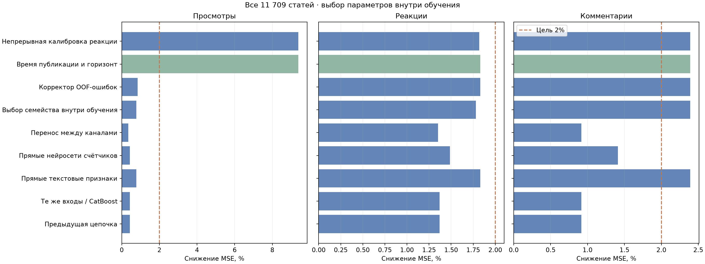
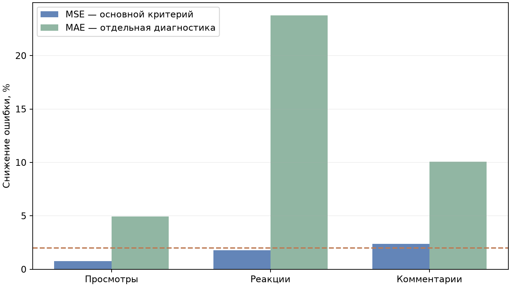

# Альтернативные варианты прогноза социальных метрик

Пользователь уточнил цель: **минимум 2% снижения MSE относительно среднего канала отдельно для просмотров, реакций и комментариев**. Это заменяет прежний целевой порог 5%. В этом исследовании проверены все **11 709 статей / 146 ресурсов**; рабочие веса и БД сохранены.

## Результаты по основному критерию

| Вариант | Просмотры: снижение MSE | Реакции | Комментарии |
| --- | ---: | ---: | ---: |
| Предыдущая цепочка | +0.44% | +1.37% | +0.92% |
| Те же входы / CatBoost | +0.44% | +1.37% | +0.92% |
| Прямые текстовые признаки | +0.78% | +1.83% | +2.39% |
| Прямые нейросети счётчиков | +0.44% | +1.49% | +1.41% |
| Перенос между каналами | +0.35% | +1.35% | +0.92% |
| Выбор семейства внутри обучения | +0.78% | +1.78% | +2.39% |
| Корректор OOF-ошибок | +0.84% | +1.83% | +2.39% |
| Время публикации и горизонт | +9.38% | +1.83% | +2.39% |
| Непрерывная калибровка реакции | +9.38% | +1.82% | +2.39% |

**Цель 2% для каждой метрики пока не достигнута. Рабочая пара не заменена.**

С дополнительными календарными входами просмотры улучшились на **9.38%**, реакции — на **1.83%**, комментарии — на **2.39%**. Два из трёх показателей проходят целевой порог. Для реакции он ещё не выполнен.

## Что проверено

1. Прежние входы модуля 4: тема, ресурс, источник, аудитория и прогноз оценки. Проверены CatBoost с нативными категориями, Ordered boosting, RMSE и Poisson, глубины 4/6.
2. Прямой SBERT текста и PCA; слова и символьные сочетания TF-IDF; абсолютные и нормированные на аудиторию остатки; несколько уровней регуляризации и смешивания со средним канала. Всего 38 базовых конфигураций и четыре силы отклонения от среднего.
3. Три независимые нейронные модели счётчиков: обычная MSE, MSE нормированных величин, PCA и пуассоновская вероятность. Выходы счётчиков не ограничиваются шкалой оценки [-10,10]. Исправлено лишнее вычитание единицы из среднего Poisson; после исправления повторена полная проверка. Старые экспериментальные артефакты имеют совместимый режим прежнего выхода; в этом отчёте используются результаты v2.
4. Перенос относительного отклонения от среднего между похожими текстами разных каналов. Для обучающей нормировки собственная группа текстов исключена из среднего канала; варианты соседей, температуры сходства, исключения собственного ресурса и ограничения обучающего отношения.
5. Семейство для каждой метрики выбирается по общей внутренней проверке обучающей части, а не по итоговым внешним ответам.

6. Небольшой корректор учится на OOF-прогнозах трёх метрик. Он поднял просмотры до 0.84%, но не дал прорыва по реакции. Фактические метрики проверочных статей в корректор не подаются.
7. Публикация по местному времени UTC+3, циклические признаки часа/дня недели и номинальный горизонт наблюдения. Горизонт рассчитан по замороженному моменту сбора соответствующей когорты и дате публикации. Для рабочего прогноза эти входы должны означать планируемое время публикации и время, через которое нужны метрики.
8. Непрерывный коэффициент реакции оценён по обучающим OOF-прогнозам. Он не улучшил основной результат, поэтому этот вариант отклонён.

**Ограничение календарного варианта:** в одном срезе смешиваются возраст поста и изменение интереса канала со временем. Результат 9,38% нельзя считать доказанной точностью прогноза ровно через 7 дней: для этого нужны повторные замеры одних статей и новый временной контроль. Этот вариант не включён в рабочую программу автоматически.

Прямые текстовые варианты требуют дополнительного входа в модуль 4 (текст или уже вычисленный SBERT). Они остаются исследовательскими; модуль 3 по-прежнему получает только текст и тему, без канала.

## Ограничение выборки и другой взгляд на ошибку

Самый большой пример даёт **96.18%** суммы квадратов ошибок среднего канала по реакциям. Это текст с голосованием реакциями: 160 347 реакций при 264 427 просмотрах. Запись сохранена в итоговом расчёте. Во всей выборке следующий максимум реакций — 9160.

Простое текстовое правило нашло **5** голосований реакциями. Это диагностическая оценка, а не полная ручная разметка форматов. У остальных совпадений не больше 493 реакций. Из этих данных нельзя уверенно выучить ожидаемый масштаб редкой крупной кампании только перебором гиперпараметров. Требуются дополнительные сопоставимые примеры или явный учёт формата и ожидаемого продвижения публикации.

MAE ниже приводится отдельно. Она линейно учитывает крупные отклонения и отвечает на иной вопрос, чем MSE; её улучшение не выдаётся за выполнение поставленного порога MSE.

| Метрика | Снижение MSE объединённого варианта | Снижение MAE |
| --- | ---: | ---: |
| Просмотры | +0.78% | +4.93% |
| Реакции | +1.78% | +23.77% |
| Комментарии | +2.39% | +10.07% |

## Время и воспроизводимость

Максимальный полный прогретый ответ: **8.675 с**. Для календарного варианта — **3.092 с**. Проверены все пять исследовательских пар через отдельное локальное ASGI-приложение: по 12 реальных текстов и 50 000 символов. Включены SBERT полного текста, автоопределение темы, оценка, три социальных прогноза и JSON; исключены первая загрузка, БД, сеть и LLM. Время обучения не участвовало в выборе.

До измерения времени повторно загруженные модели в точности воспроизвели все 11 709 сохранённых социальных прогнозов. Для общей предобработки введён кэш одного запроса; три целевые головы имеют отдельные параметры, неизменность прогнозов при кэшировании проверена. Прошли 179 Python-тестов и 14 JS-тестов.

Пять внешних групповых разбиений исключают одинаковые нормализованные тексты между обучением и проверкой. Каждая статья проверена ровно один раз. Внутренние разбиения одинаковы для всех семейств, выбор сделан по внутренним ошибкам. Словари, масштабы, PCA и средние обучаются только на обучающих строках. Для новой семейной проверки использованы замороженные обучающие OOF-оценки предыдущей цепочки. Сами внешние проверочные метрики нигде не подаются на вход.

Корпус использовался в предыдущих исследованиях. Результаты описывают полную повторную проверку имеющихся данных; независимый контроль будущих дат пока отсутствует. Сырые тексты, матрицы и промежуточные веса не включены в GitHub-копию. Все отпечатки исходных текстов проверены; данные БД не изменялись.

[MSE и MAE по каждому варианту](metrics.csv) · [Сводка](summary.json) · [Выбор семейства](combined_report.json) · [Время ответа](latency.json)
