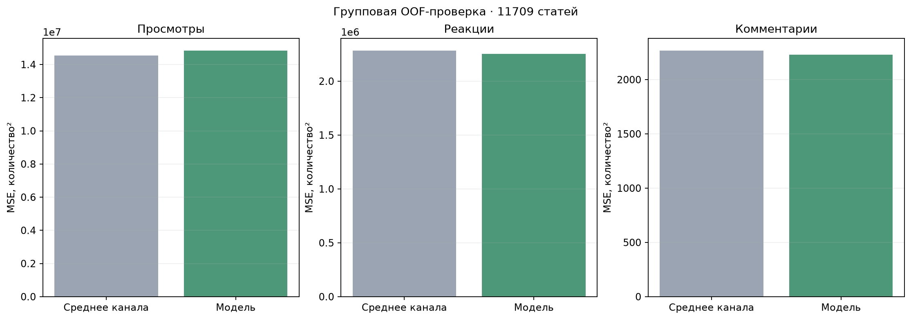

# Проверка модуля социальных метрик на всей выборке

Оценены **11709 статей**, **11549 разных нормализованных текстов**, **146 каналов**. Каждая строка проверена ровно один раз в пяти групповых разбиениях. Совпадающие тексты не пересекаются между обучением и проверкой. Среднее канала рассчитывается только по обучающей части каждого разбиения. Рабочие веса и БД не изменялись.

Изменение общей нормированной MSE относительно среднего канала: **0.21% снижения**. Отрицательное снижение означает ухудшение. MSE каждой строки нормируется на дисперсию соответствующей обучающей части.

| Метрика | MSE среднего канала | MSE модели | RMSE среднего | RMSE модели | Снижение MSE |
| --- | ---: | ---: | ---: | ---: | ---: |
| Просмотры | 14540292.88 | 14825676.81 | 3813.17 | 3850.41 | -1.96% |
| Реакции | 2281769.90 | 2252588.84 | 1510.55 | 1500.86 | 1.28% |
| Комментарии | 2265.21 | 2229.89 | 47.59 | 47.22 | 1.56% |

## Границы проверки

Это OOF-проверка модуля 4 при фиксированных входных прогнозах текстовой модели. Для новых пяти разбиений текстовые сети заново не обучались: их исторические OOF-разбиения отличаются. Поэтому эта проверка не является полностью вложенной проверкой всей цепочки модулей 3–4. Конфигурация также ранее выбиралась на части этого корпуса. Числа описывают всю имеющуюся выборку, но не заменяют независимую проверку будущих публикаций.

Случайные группы могут использовать более новые публикации при прогнозе старых. Отдельный хронологический контроль на 216 новых статьях сохранён в [предыдущем отчёте](../2026-11-11-history/README.md). Его результат: снижение общей ошибки на 4,62%.

Код: `model_tests/evaluate_full_history.py`. Полные прогнозы по строкам хранятся только локально; публикуются агрегированные показатели.

## Дополнительный прогон сохранённых рабочих весов

Это не кросс-валидация: рабочая модель уже обучалась на 11 493 строках.

| Часть | Статей | Снижение общей ошибки |
| --- | ---: | ---: |
| Обучающие, уже изученные | 11493 | -0.71% |
| Отдельный временной контроль | 216 | 4.62% |
| Все вместе, смешанная оценка | 11709 | -0.67% |

Обучающая и смешанная оценки не доказывают качество новых прогнозов.
