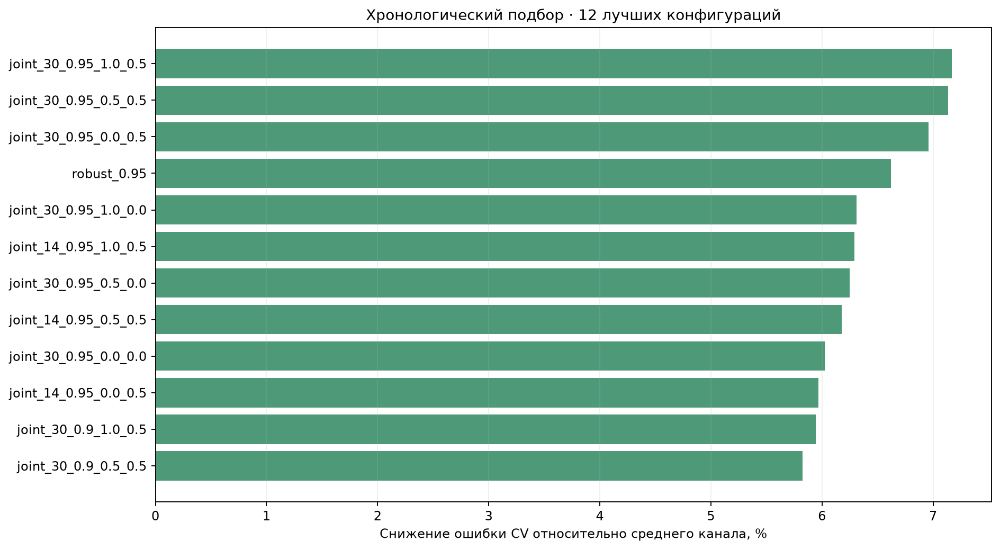
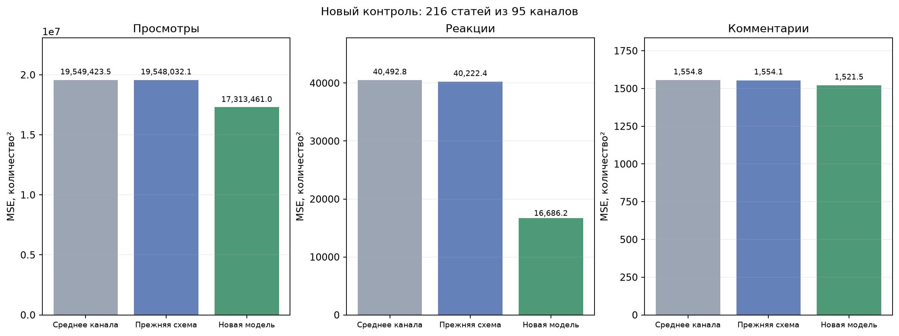
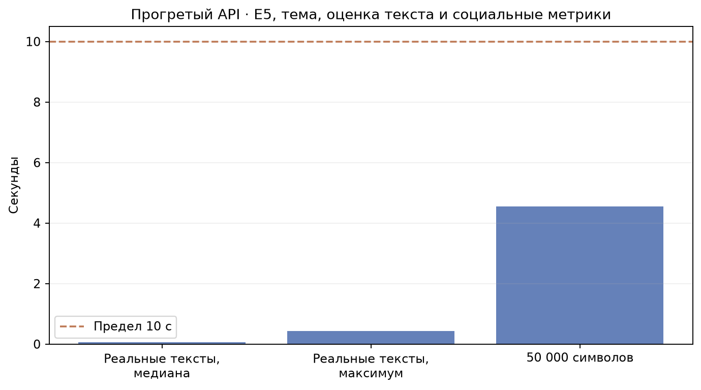

# История канала, тема и оценка текста — 11 ноября 2026

На новом контроле из **216 статей / 95 каналов** общая нормированная MSE ниже среднего канала на **4.62%**, ниже прежней конфигурации на **4.56%**. По точечным оценкам ошибка снизилась по всем трём социальным метрикам.

**Неопределённость:** 95% интервал bootstrap по каналам для разности общей ошибки «среднее минус кандидат» равен [-0.003748; 0.024917] и включает ноль. Эта выборка показывает улучшение, но пока не подтверждает устойчивый общий выигрыш на уровне 95%. Контрольные тексты не добавлялись в обучение после измерения.

## Что изменилось

В модуле 4 выбрана условная регрессия по истории канала. Входы прогноза сохранены: тема, оценка текстовой модели, ресурс, вид источника и аудитория из каталога. Текстовая нейросеть не переобучалась и по-прежнему получает только текст и тему.

1. Публикации каждого канала сортируются по времени. Вес уменьшается вдвое через каждые 30 более новых постов; это половинный вес по числу публикаций, а не окно только из последних 30 статей.
2. Только при обучении значения выше 95-го процентиля истории данного канала ограничиваются этим порогом при расчёте статистик. Это уменьшает влияние отдельных всплесков; исходные данные и проверочные ответы не изменяются.
3. Средний отклик уточняется по теме внутри канала. Редкие сочетания темы и канала стягиваются к общему уровню (параметр регуляризации 20).
4. Учитывается отклонение прогнозной оценки текста от средней оценки канала. Локальный коэффициент оценивается с ridge-регуляризацией 100; используется половина поправки.

Каждая метрика получает свой набор статистик и коэффициентов. При обучении нужны даты публикаций; при прогнозе дата не требуется. Если пользовательский `fit` получает канал с неполными датами, в нём применяются равные веса вместо произвольного порядка строк. В рабочей паре даты известны для всех 11 493 строк.

## Подбор и отдельный контроль

Проверено 97 конфигураций, включая среднее канала и прежнюю схему CatBoost. Материал: прежние 10 182 строки и 1311 дополнительных уникальных текстов. Дополнительные данные прошлой проверки теперь считаются обучающими/валидационными. В трёх хронологических разбиениях каждого канала использованы первые 40%, 60%, 80% его истории для обучения и следующие 20% для оценки. Во всех разбиениях имеется также прежний обучающий корпус. Входные оценки текста дополнительных статей получены сетью, не обучавшейся на этих статьях.

Выбрана `joint_30_0.95_1.0_0.5`. Среднее отношение ошибки к среднему канала по CV — 0.928328; снижение около 7.17%. Кандидат лучше среднего на всех трёх временных частях. Время обучения не участвует в выборе.



До сбора новых контрольных статей зафиксированы конфигурация и интервал публикаций: **2026-11-09T11:28:29.237236+00:00 — 2026-11-09T14:32:32+00:00**, границы исключены. Эти публикации позже всех обучающих текстов. Точные нормализованные повторы прежнего корпуса исключены. Каналы в контроле уже представлены старшими обучающими постами. Рабочая БД не изменялась. Возраст новых контрольных статей — около двух дней; обучающие наблюдения относятся к возрастам 2–14 дней.

Прежняя конфигурация CatBoost заново обучена на тех же 11 493 строках. Таким образом, сравниваются алгоритмы при одинаковой обучающей истории. Среднее канала также рассчитано только по этим обучающим строкам.

| Метрика | MSE среднего канала | MSE прежней схемы | MSE новой модели | Снижение относительно среднего |
| --- | ---: | ---: | ---: | ---: |
| Просмотры | 19549423.54 | 19548032.12 | 17313460.95 | 11.44% |
| Реакции | 40492.75 | 40222.37 | 16686.20 | 58.79% |
| Комментарии | 1554.82 | 1554.06 | 1521.54 | 2.14% |

Общая нормированная MSE: **0.198457 → 0.189281**. Нормировка — дисперсия каждой метрики всех обучающих строк, одинаковая для моделей. Это не процент точности отдельных публикаций. Проценты прежнего исследования на другой контрольной выборке напрямую не сравниваются с этими числами.



## Время ответа

Максимум полного прогретого локального API на 12 реальных текстах: **0.435 с**; 50 000 символов: **4.555 с**. Предел 10 секунд соблюдён. Включены E5, автоматическое определение темы, текстовая оценка, прогноз трёх метрик и JSON. Используется замороженный каталог ресурсов; БД, сеть и LLM не входят в замер. Начальная загрузка 11.74 с измерена отдельно. Это результаты выбранных примеров на текущем компьютере. 



## Воспроизведение

Исследовательский код находится в `model_tests/`. Для повторения нужны локальные снимки предыдущих исследований, авторизованная Telegram-сессия, E5 и конфигурация `.env`. Тексты, исходные признаки, ключи и сессии не публикуются. Новый контроль нельзя повторно использовать для выбора настроек.

```powershell
.\.venv312\Scripts\python.exe -m model_tests.prepare_history_study --output model_tests/results/new_history --as-of "<UTC ISO timestamp>"
.\.venv312\Scripts\python.exe -m model_tests.tune_history --directory model_tests/results/new_history
.\.venv312\Scripts\python.exe -m model_tests.collect_history_control --directory model_tests/results/new_history
.\.venv312\Scripts\python.exe -m model_tests.confirm_history --directory model_tests/results/new_history
.\.venv312\Scripts\python.exe -m model_tests.build_history_pair --directory model_tests/results/new_history --output artifacts/new_history
.\.venv312\Scripts\python.exe -m model_tests.benchmark_history_api --directory model_tests/results/new_history --model-file artifacts/new_history/model.joblib
```

Время `--as-of` задаёт верхнюю границу новой контрольной публикации как «время минус два дня». Для следующего исследования нужен другой, ещё не изученный контрольный интервал. Для обычного обучения на текущей БД используется `python -m src.social_metrics_prediction train`; эта команда получает даты публикаций через модуль БД.
