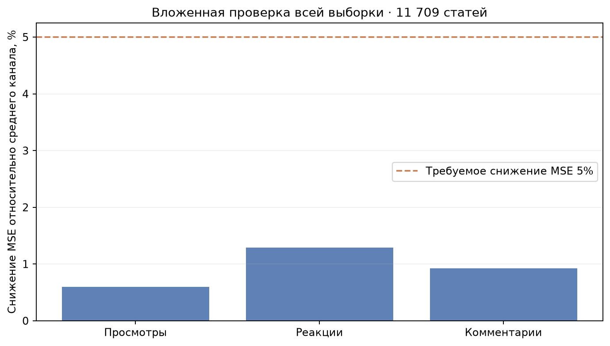

# Независимые модели социальных метрик: проверка всей выборки

Обновление после этого эксперимента: миграция `embedding_model` и полный пересчёт векторов выполнены, данные сохранены. [Проверка БД и следующий подбор](../2026-11-11-reembed-models/README.md).

**Порог снижения MSE на 5% для каждой метрики не достигнут. Рабочие веса не заменены.** Реализованы отдельные классы `ViewsModel`, `ReactionsModel`, `CommentsModel`; каждый получает собственную конфигурацию и собственный выбор по ошибке своей целевой метрики.

## Протокол

Все 11 709 статей (11 549 нормализованных текстов, 146 каналов) проверены ровно один раз в пяти внешних групповых разбиениях. Совпадающие тексты не пересекаются. Внутри каждой обучающей части выбрана конфигурация текстовой сети из трёх вариантов, заново получены её обучающие OOF-прогнозы и прогнозы внешней проверки. Для каждого социального показателя независимо выбирается одна из 114 конфигураций: история/тема/локальная калибровка, ridge, ExtraTrees, бустинг или CatBoost; рассматриваются абсолютные и относительные остатки. Внешние проверочные ответы не участвуют в подборе. Среднее канала вычисляется на той же обучающей части.

Внутренняя настройка социальных моделей использует только обучающие upstream OOF-оценки; внешний тест исключён из всей цепочки обучения и выбора. Корпус уже исследовался ранее: это вложенная проверка имеющихся данных, а не новый независимо собранный временной контроль.

| Метрика | MSE среднего | MSE модели | Снижение MSE | Порог 5% |
| --- | ---: | ---: | ---: | --- |
| Просмотры | 14540292.88 | 14453166.31 | 0.60% | не достигнут |
| Реакции | 2281769.90 | 2252404.96 | 1.29% | не достигнут |
| Комментарии | 2265.21 | 2244.22 | 0.93% | не достигнут |



## Настройки отдельных моделей

| Внешняя часть | Просмотры | Реакции | Комментарии | Текстовая сеть |
| --- | --- | --- | --- | --- |
| 1 | robust_0.95 | joint_30_0.95_1.0_0.5 | robust_0.9 | compact |
| 2 | cat_3_True | ridge_10000.0_False | joint_30_0.9_1.0_0.5 | wide_short |
| 3 | robust_0.95 | joint_30_0.95_0.0_0.5 | joint_30_0.9_1.0_0.5 | wide_short |
| 4 | robust_0.98 | joint_30_0.95_1.0_0.5 | joint_30_0.9_1.0_0.5 | wide_short |
| 5 | robust_0.98 | joint_30_0.95_1.0_0.5 | joint_30_0.9_0.5_0.5 | wide_short |

В `outer_1`…`outer_5` локально сохранены отдельные `views.joblib`, `reactions.joblib`, `comments.joblib` и данные выбора конфигураций. Они не включены в публичную папку и не активированы в приложении.

## Текстовая нейросеть

Фиксированная текущая конфигурация: MSE полной OOF-проверки **10.1312**. Внутренний выбор конфигураций: **10.0081**, снижение примерно **1.22%**. Вход остаётся «текст и тема». Поскольку требование качества социальных моделей не выполнено, согласованная рабочая пара не заменена. Время обучения не используется как критерий выбора.

## Ограничения и проверка оптимизированных модулей

Все 151 исходная модульная проверка прошли до изменения конфигурации эмбеддингов. Численная формула `log-activity-v3` проверена на 10 000 наборов входов; сохранённые метки согласуются с оптимизированной реализацией. Рабочие артефакты успешно загружаются, выходы конечны и ограничены. Новые признаки для 1527 дополнительных текстов получены текущей реализацией E5; 10 182 старых признака взяты из локального исторического снимка с известной моделью.

Прямая проверка БД обнаружила незавершённую миграцию: отсутствует столбец `article_vectors.embedding_model`. Обучение и RAG по этим векторам блокируются до `python -m src.database reembed`. Эта проверка использовала замороженный корпус и БД не изменяла.

В прежней полной OOF-проверке одна статья со 160 347 реакциями давала примерно 96,18% суммы квадратов ошибок среднего канала по реакциям. Запись сохранена в проверке; большие наблюдения не удалялись из контрольных ответов ради выполнения порога.

## Воспроизведение

```powershell
.\.venv312\Scripts\python.exe -m model_tests.prepare_per_metric --output model_tests/results/new_per_metric
.\.venv312\Scripts\python.exe -m model_tests.nested_per_metric --directory model_tests/results/new_per_metric
.\.venv312\Scripts\python.exe -m model_tests.text_default_full_baseline --directory model_tests/results/new_per_metric
```

Требуются локальные исторические снимки; после смены эмбеддера старые матрицы признаков повторно использовать нельзя. Методика вложенного выбора: [scikit-learn](https://scikit-learn.org/stable/auto_examples/model_selection/plot_nested_cross_validation_iris.html).
