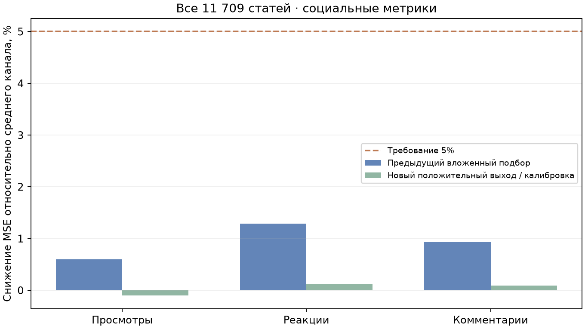
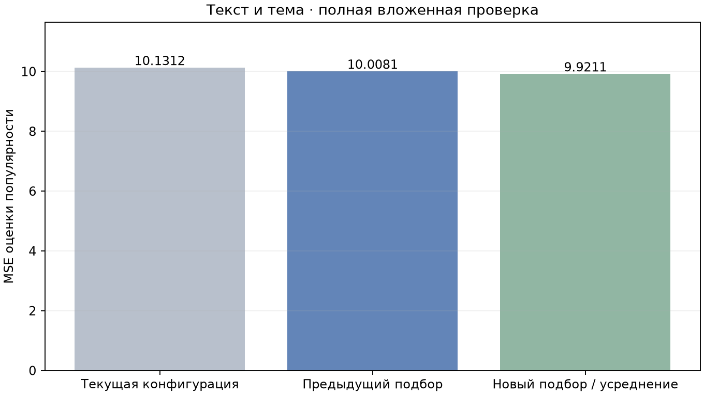

# Пересчёт векторов и дальнейший подбор моделей

## База данных

Полный `reembed` выполнен для **10 182 статей / 91 ресурса**. Использован текущий профиль `intfloat/multilingual-e5-small`, 384 компоненты, префиксы `passage` / `query`. Все векторы имеют метаданные профиля и правильную размерность; несовместимых записей — **0**. Ни одна статья не была пропущена из-за параллельного изменения.

До операции создана локальная резервная копия `artifacts/backups/before_reembed_20261111_1820.dump`; архив проверен через `pg_restore --list` и содержит данные всех пяти таблиц. Дамп в публичную копию не включён.

SHA-256 полного содержимого таблиц `resource`, `article_text`, `article_sources`, `article_metrics` до и после совпали. Тексты, темы, ID, аудитории и метрики сохранены. Максимальная ошибка единичной нормы: 3.02e-08. Все 10182 старых признака совпадают с пересчитанными векторами с точностью до 2.23e-08 по координатам; замороженный E5-корпус для экспериментов остаётся совместимым.

Проверено реальное чтение 10 182 обучающих строк, ближайшая статья по собственному вектору (расстояние 0), поиск популярных похожих статей и пять лучших примеров по теме. Проблема отсутствовавшего `embedding_model`, описанная в предыдущем отчёте, устранена.

## Социальные метрики

Для просмотров, реакций и комментариев независимо проверены 27 конфигураций модели с положительным мультипликативным выходом: логарифм отклонения от среднего канала, нелинейные преобразования оценки, взаимодействия с темой и ресурсом, регуляризация и калибровка среднего только на обучающей части. Среднее канала также включено в число кандидатов. Цели проверки не обрезались и не удалялись.

Пять внешних групповых разбиений охватывают **11 709 статей / 11 549 разных нормализованных текстов / 146 ресурсов**. Каждая статья проверена ровно один раз. Совпадающие тексты не пересекаются между обучением и проверкой. Оценки популярности взяты из предыдущей вложенной подготовки: проверочные метрики не подаются на вход. Выбор социальных конфигураций проводится только на обучающих строках. Среднее нормируется на аудиторию; вычисляется на той же обучающей части.

| Метрика | MSE среднего | MSE нового кандидата | Снижение MSE | Прежний вложенный подбор |
| --- | ---: | ---: | ---: | ---: |
| Просмотры | 14540292.88 | 14554844.64 | -0.10% | +0.60% |
| Реакции | 2281769.90 | 2278961.07 | +0.12% | +1.29% |
| Комментарии | 2265.21 | 2263.18 | +0.09% | +0.93% |

**Новый социальный кандидат отклонён:** улучшения прежнего результата нет, порог 5% по каждой метрике не достигнут. Рабочие веса сохранены.



Одна статья со 160 347 реакциями даёт около 96,18% суммы квадратов ошибок среднего канала по реакциям. Это ограничение данной выборки; запись сохранена в оценке. Подмена MSE другой метрикой или удаление этой статьи не использовались.

## Нейросеть по тексту

Вход остаётся только «текст и тема». Проверены четыре архитектуры и один/два независимых начальных состояния. Архитектура и число сетей выбираются на двух внутренних разбиениях каждой внешней обучающей части. Прогноз двух сетей усредняется; это исследовательский вариант, не дополнительный вход модели.

MSE текущей конфигурации на всех статьях: **10.1312**. Предыдущий вложенный подбор: **10.0081**. Новый: **9.9211** — 2.07% относительно текущей конфигурации и 0.87% относительно прошлого подбора. Парный bootstrap по каналам (2000 повторов), 95% интервал последнего улучшения: [-0.68%; 2.79%]. Интервал включает ноль; устойчивое превосходство над предыдущим подбором пока не подтверждено.

| Внешняя часть | Выбор по обучающим данным | Проверочная MSE | Максимальное время только сети, с |
| --- | --- | ---: | ---: |
| 1 | wide_regularized:2 | 9.6539 | 0.002010 |
| 2 | wide_regularized:2 | 10.2871 | 0.001863 |
| 3 | wide_regularized:2 | 10.1329 | 0.001593 |
| 4 | wide_regularized:2 | 10.0236 | 0.001311 |
| 5 | wide_regularized:2 | 9.5052 | 0.001110 |



Согласованная рабочая пара не заменена: улучшение текстовой MSE отдельно не подтверждает выполнение требования для социальных метрик. Время обучения не использовалось при выборе. Приведённое время нейросетевого слоя исключает SBERT, загрузку и LLM; оно не выдаётся за полное время ответа приложения. Ранее проверенная рабочая пара остаётся прежней.

## Ограничения и воспроизведение

Корпус уже использовался в исследованиях. Это проверка всех имеющихся данных с вложенным выбором, а не новый независимый контроль будущих публикаций. Случайное групповое разбиение не доказывает качество на будущих датах. Внутренний социальный подбор повторно использует upstream OOF-прогнозы внешней обучающей части; внешние проверочные ответы исключены из всей цепочки.

```powershell
.\.venv312\Scripts\python.exe -m src.database reembed
.\.venv312\Scripts\python.exe -m model_tests.evaluate_count_links --corpus model_tests/results/per_metric_20261111 --output model_tests/results/new_count_links
.\.venv312\Scripts\python.exe -m model_tests.evaluate_text_ensembles --corpus model_tests/results/per_metric_20261111 --output model_tests/results/new_text_ensembles
```

Нужны локальные замороженные снимки предыдущего исследования; сырые тексты, разбиения, дамп и промежуточные веса в GitHub-копию не включены. Агрегированные результаты: [summary.json](summary.json), [metrics.csv](metrics.csv), [нейросети](neural_network_report.json), [социальные модели](positive_link_report.json).
