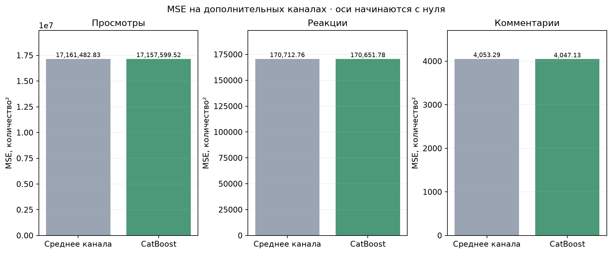
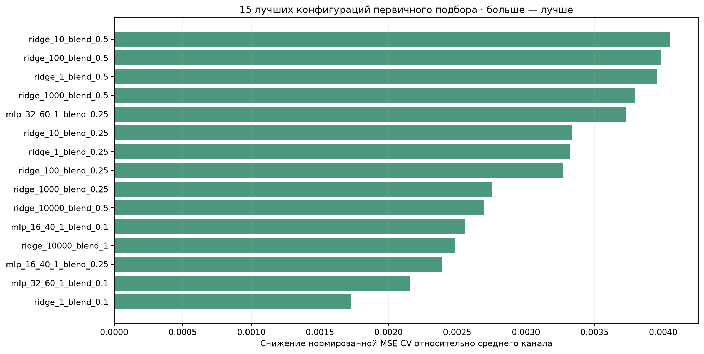
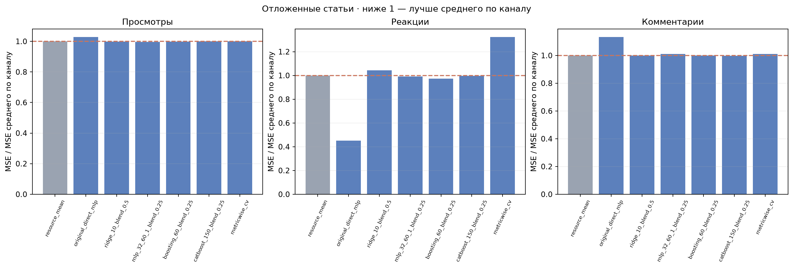
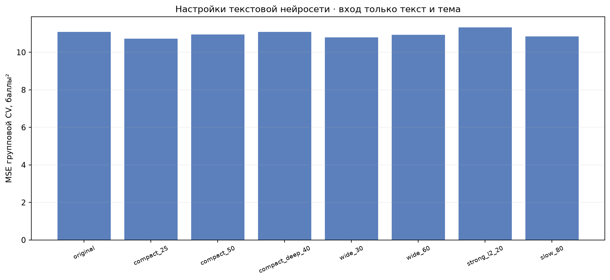

# Подбор конфигураций прогнозных моделей — 11 ноября 2026

Цель — улучшить прогноз социальных метрик относительно среднего по каналу. Вход текстового модуля сохранён: только текст и тема. Канал известен исключительно модулю социальных метрик.

## Итог дополнительной проверки

Для модуля социальных метрик выбран **CatBoost с поправкой к среднему канала**: `catboost_150_blend_0.25`. На 282 более новых статьях из 53 дополнительных каналов общая нормированная MSE ниже среднего канала на **0.108%**. Снижение есть по каждой из трёх метрик. Выигрыш небольшой; это не обещание точности для каждой будущей статьи.

**Почему понадобилась дополнительная проверка.** Конфигурация с минимальной средней CV MSE не подтвердила преимущество на старой отложенной части; результаты приведены в таблице ниже. После этого использован более консервативный критерий: минимальное худшее отношение ошибки CV к среднему канала, с улучшением во всех трёх частях. До чтения новых статей зафиксирован CatBoost. Новая проверочная часть не использовалась для выбора конфигурации.

Прочитаны 1311 дополнительных текстов из 55 ранее отобранных публичных каналов. Из них 1293 уникальных текстов из 53 каналов с минимум 10 статьями вошли в проверку: старшие 80% (1011) каждого канала использованы для обучения с прежними 10 182 строками, младшие 20% (282) оставлены для проверки. Точные повторы прежних и новых текстов исключены. Канал известен обоим прогнозам по его старшим публикациям. Публикации относятся к тому же окну возраста 2–14 дней; данные не собраны в будущую дату.

| Метрика | MSE среднего канала | MSE CatBoost | RMSE среднего | RMSE CatBoost | Снижение MSE |
| --- | ---: | ---: | ---: | ---: | ---: |
| Просмотры | 17161482.83 | 17157599.52 | 4142.642 | 4142.173 | 0.023% |
| Реакции | 170712.76 | 170651.78 | 413.174 | 413.100 | 0.036% |
| Комментарии | 4053.29 | 4047.13 | 63.665 | 63.617 | 0.152% |

Общая нормированная MSE: 0.15915918 → 0.15898772. Шкалы дисперсии рассчитаны на обучающих строках новых каналов и одинаковы для обоих прогнозов. 95% интервал парного bootstrap по каналам для разности «среднее минус модель»: [0.00000847; 0.00043164]. Он положителен в этой выборке; оценка остаётся зависимой от каналов и срока наблюдения.

Прогретый полный ответ с E5: максимум 0.430 с на восьми статьях разной длины; текст из 50 000 символов — 3.916 с. Предел 10 секунд соблюдён. Загрузка моделей, БД, сеть и LLM не входят в это измерение.

Рабочие веса собираются **без повторного обучения на проверочных статьях**: текстовая сеть обучена на 8143 прежних строках, социальная модель — на 11193 строках. Совпадение прогнозов приложения и экспериментальной модели проверяется перед заменой. Старая пара сохранена локально. Исходная рабочая БД содержит прежние 10 182 статьи и не изменялась этим подбором.



## Первичный подбор: протокол и ограничения

Использована та же выборка из 10 182 статей / 91 канала: 8143 строки для подбора, 2039 отложенных. Проверены 8 конфигураций текстовой нейросети и 15 конфигураций моделей поправки к среднему канала с четырьмя коэффициентами поправки (60 комбинаций). Дополнительно проверена комбинация настроек, отдельно выбранных по CV для каждой метрики и зафиксированных до просмотра новых тестовых результатов. Подбор выполняется по групповой CV. Средние каналов, словари, нормировка и коэффициенты вычисляются только на обучающей части.

Для подтверждения заново рассчитаны входные текстовые оценки: выбор конфигурации текстовой сети внутри каждого обучения использует две внутренние части; прогнозы для обучения социальных моделей получены трёхчастным cross-fitting. Проверяемая группа не участвует ни в обучении сети, ни в выборе её конфигурации. После фиксации выбора по CV рассчитаны ошибки отложенных статей.

**Отложенная часть уже использовалась в предыдущем сравнении моделей.** В текущем подборе её ошибки раскрыты после фиксации конфигураций, но это не новая независимая выборка. Нужна последующая проверка на публикациях новых дат. Все записи, включая редкий большой счётчик реакций, сохранены. Время обучения не участвует в выборе; предел прогноза после загрузки остаётся 10 секунд.

## Прогноз социальных метрик

По CV выбран вариант **mlp_32_60_1_blend_0.25**. Общий критерий — среднее MSE трёх метрик, нормированное на дисперсию каждой метрики обучающей части.

| Конфигурация | Норм. MSE CV | Норм. MSE проверки | RMSE просмотров | RMSE реакций | RMSE комментариев |
| --- | ---: | ---: | ---: | ---: | ---: |
| resource_mean | 12.828513 | 0.106840 | 2849.55 | 274.08 | 23.55 |
| original_direct_mlp | 12.837089 | 0.114930 | 2890.08 | 184.25 | 25.07 |
| ridge_10_blend_0.5 | 12.827815 | 0.107074 | 2845.95 | 280.02 | 23.54 |
| mlp_32_60_1_blend_0.25 | 12.827011 | 0.107714 | 2842.60 | 272.83 | 23.68 |
| boosting_60_blend_0.25 | 12.828228 | 0.106625 | 2847.57 | 270.26 | 23.55 |
| catboost_150_blend_0.25 | 12.827886 | 0.106655 | 2849.48 | 273.77 | 23.53 |
| metricwise_cv | 12.832542 | 0.110331 | 2849.69 | 315.37 | 23.68 |

Первичный вариант с минимальной средней CV MSE: Ошибка выше среднего по каналу на **0.82%**. Процент описывает изменение ошибки, а не точность отдельных прогнозов. Изменения по отдельным метрикам показаны на графике ниже.

Парный групповой bootstrap: разность ошибок «среднее канала минус модель» — -0.000874; 95% интервал [-0.002883; 0.000980]. Положительная разность соответствует улучшению. Интервал описательный с учётом повторного использования данных.





## Оценка популярности по тексту

Конфигурация итоговой сети для оценки: `wide_60`. MSE отложенной части: 9.7868; RMSE: 3.1284 балла. Диагностическое среднее по каналу: MSE 4.9208. Это среднее использует источник, которого нет во входе текстовой сети, и не заменяет её при прогнозе.



## Файлы и повторение

`screening.json`, `confirmation.json` и `metrics.csv` содержат все агрегированные результаты. Код подбора и подтверждения находится в `model_tests/`, вне кода приложения. Исходные тексты, признаки, промежуточные веса и входные оценки остаются только локально.

```powershell
.\.venv312\Scripts\python.exe -m model_tests.tune_models --output model_tests/results/new_tuning
.\.venv312\Scripts\python.exe -m model_tests.confirm_tuning --screening model_tests/results/new_tuning/screening.json --output model_tests/results/new_tuning/confirmation
.\.venv312\Scripts\python.exe -m model_tests.confirm_metricwise_tuning --directory model_tests/results/new_tuning
.\.venv312\Scripts\python.exe -m model_tests.tuning_report --directory model_tests/results/new_tuning
```

Повторение требует локального снимка предыдущего исследования в `model_tests/results/expansion_20261111`; он не публикуется вместе с исходным кодом. Рабочая БД не изменяется при подборе.

## Дополнительная проверка: повторение

Замороженные настройки: `fresh_choices_frozen.json`. Код чтения новых каналов — `model_tests.collect_fresh_confirmation`, проверки — `model_tests.confirm_fresh_tuning`. Сбор не вступает в каналы, не публикует сообщения и не записывает в рабочую БД. Один и тот же новый тест повторно не используется для подбора.

```powershell
.\.venv312\Scripts\python.exe -m model_tests.freeze_robust_profile --directory model_tests/results/new_tuning
.\.venv312\Scripts\python.exe -m model_tests.collect_fresh_confirmation --directory model_tests/results/new_tuning --target 1500
.\.venv312\Scripts\python.exe -m model_tests.confirm_fresh_tuning --directory model_tests/results/new_tuning
.\.venv312\Scripts\python.exe -m model_tests.benchmark_tuned_latency --directory model_tests/results/new_tuning --fresh
.\.venv312\Scripts\python.exe -m model_tests.build_tuned_pair --directory model_tests/results/new_tuning --output artifacts/new_candidate
```

Методика разделения выбора и оценки: [документация scikit-learn](https://scikit-learn.org/stable/auto_examples/model_selection/plot_nested_cross_validation_iris.html).
