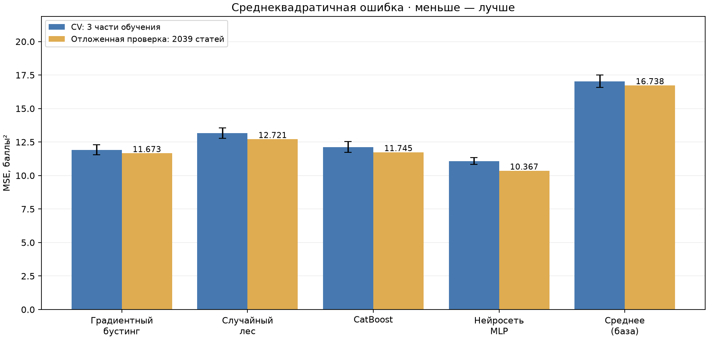
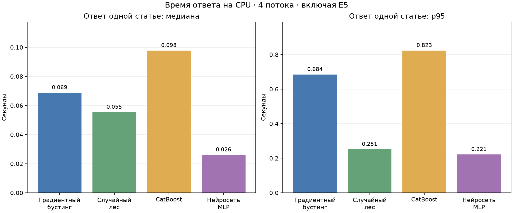
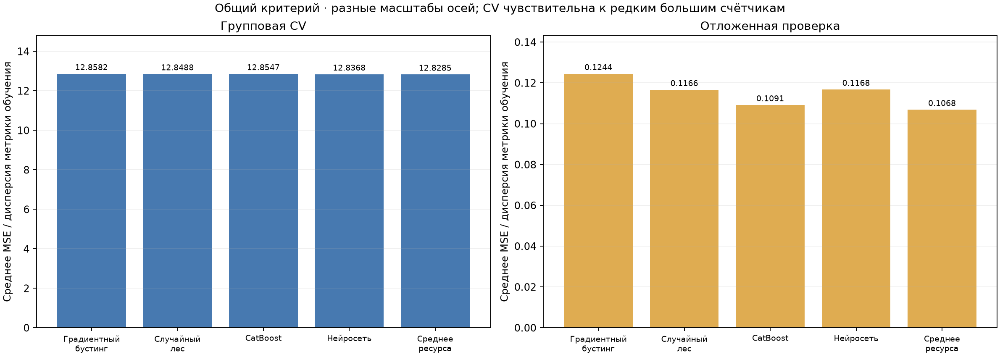
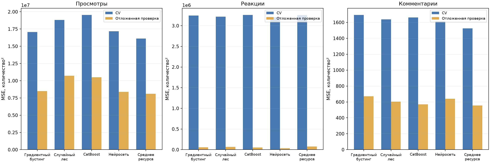
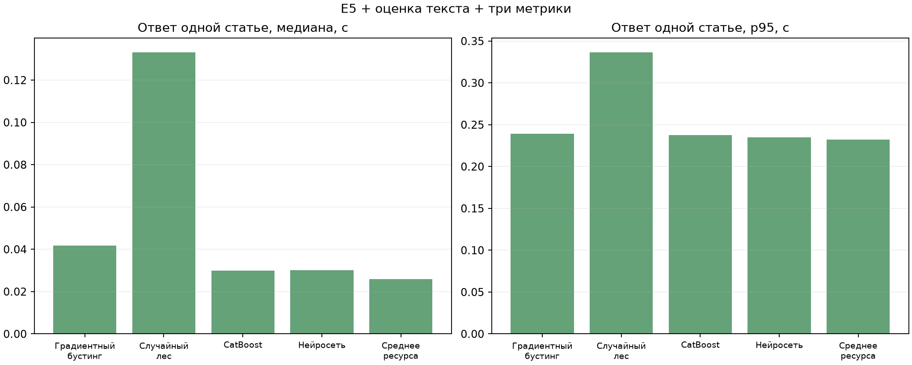

# Расширение выборки и сравнение моделей — 11 ноября 2026

В БД собраны **10 182 статьи из 91 Telegram-канала**, включая **10 022 различных нормализованных текста**. Согласованная рабочая пара нейросетей переобучена на всей выборке. При выборе учитывались только ошибка CV и измеренное время ответа до 10 секунд. Время обучения не участвовало.

## Данные

Проверены 302 публичных канала; требованиям соответствовали 146, из них 122 новых относительно исходного списка. Для достижения объёма использован 91 канал; ещё 55 пригодны для дальнейшего расширения. Полный список со ссылками и числом загруженных статей: [проверенные каналы](../../../model_tests/expanded_channels_20261111.md). Настроенный список: [channels.txt](../../../src/database/channels.txt).

Момент отсчёта — 11.11.2026 11:28:29 UTC. У каждой статьи на этот момент возраст строго больше 2 и меньше 14 дней. Публикации: 28.10.2026 11:31:02 — 09.11.2026 11:25:32 UTC. Лимит — 1000 пригодных постов на канал; сбор остановлен после превышения 10 000 различных текстов. У каждого сохранённого поста открыты комментарии, доступны реакции, просмотры и аудитория положительны; неизвестных метрик нет. Известные нулевые реакции и комментарии допустимы. Представлены все 14 тем. Метки тем определены автоматически по тексту.

160 точных нормализованных повторов оставлены как отдельные публикации разных ресурсов. В разбиениях они всегда находятся в одной группе. Исходные устаревшие статьи сохранены в локальном дампе до применения штатного удаления за пределами окна. Тексты, дампы, ключи и сессия не включены в этот отчёт.

## Порядок сравнения

Одинаковое разбиение для всех моделей: 8143 статьи для обучения и CV, 2039 для отложенной проверки. Точные нормализованные тексты объединены в группы; группы не пересекаются. Использованы 3 части групповой CV, seed 42, CPU, 4 потока. E5 заморожен. Для модуля 4 входные оценки получены прогнозом модуля 3 вне обучающих групп; в CV применяется вложенное cross-fitting. Оценка из фактических социальных метрик не подаётся в признаки прогноза.

Среди четырёх обученных семейств выбирается минимальная средняя ошибка CV при максимальном измеренном полном ответе не более 10 секунд. При равной ошибке учитывается p95. Отложенная проверка не участвует в выборе, настройке и остановке обучения. Дополнительно показаны простые базовые прогнозы. Время обучения хранится в технических CSV, но не участвует в выборе и не вынесено на сравнительные графики.

Время сравнения моделей включает векторизацию полного текста E5 и регрессор; для модуля 4 также текстовую оценку и три прогноза метрик. После прогрева измерены восемь текстов разной длины из обучающей части, без БД и сети. Максимум и p95 относятся к этим выбранным примерам и оборудованию, а не к распределению пользовательского трафика.

## Модуль 3: оценка по тексту

| Модель | MSE CV | MSE проверки | RMSE проверки, баллы | Максимум ответа с E5, с |
| --- | ---: | ---: | ---: | ---: |
| Градиентный бустинг | 11.9199 | 11.6730 | 3.4166 | 0.979 |
| Случайный лес | 13.1603 | 12.7211 | 3.5667 | 0.348 |
| CatBoost | 12.1272 | 11.7448 | 3.4271 | 1.146 |
| Нейросеть | 11.0793 | 10.3668 | 3.2197 | 0.315 |
| Средняя оценка (ориентир) | 17.0312 | 16.7380 | 4.0912 | 0.347 |

Выбрана **нейросеть**. MSE отложенной проверки — **10,3668**, RMSE — **3,2197 балла** при шкале оценки от −10 до +10. MSE ниже константного среднего примерно на 38%; это уменьшение ошибки, а не процент точности. Цель — формула `log-activity-v3`.





## Модуль 4: прогноз социальных метрик

Общий критерий: MSE каждой метрики делится на её дисперсию обучающей части, затем значения усредняются по метрикам и частям CV. Ниже RMSE отложенной проверки приведена в исходных количествах.

| Модель | Норм. MSE CV | Норм. MSE проверки | RMSE просмотров | RMSE реакций | RMSE комментариев | Максимум ответа, с |
| --- | ---: | ---: | ---: | ---: | ---: | ---: |
| Градиентный бустинг | 12.8582 | 0.1244 | 2914.25 | 239.25 | 25.91 | 0.331 |
| Случайный лес | 12.8488 | 0.1166 | 3274.35 | 255.59 | 24.58 | 0.433 |
| CatBoost | 12.8547 | 0.1091 | 3238.46 | 226.38 | 23.85 | 0.337 |
| Нейросеть | 12.8368 | 0.1168 | 2894.51 | 186.13 | 25.28 | 0.335 |
| Среднее по каналу (ориентир) | 12.8285 | 0.1068 | 2849.55 | 274.08 | 23.55 | 0.332 |

Среди четырёх обученных семейств выбрана **нейросеть**. **Преимущество над средним по каналу не подтверждено**: базовый прогноз немного лучше по общему критерию CV и по общей нормированной ошибке отложенной проверки. Выбор нейросети описывает сравнение четырёх заданных семейств; утверждать, что сложная модель полезнее базовой по всем метрикам, нельзя.

CV нестабильна: для нейросети ошибки трёх частей равны 38,0515; 0,2758; 0,1832. В данных присутствует единичный пост со 160 347 реакциями (следующее по величине значение — 4310). Большие счётчики особенно сильно влияют на MSE. Запись не удалялась и не корректировалась ради результата. Причины необычного значения не проверены. Это ограничивает уверенность в небольших различиях моделей.







## Проверка рабочей пары через API редактора

После сравнения рабочие модели отдельно обучены на всех 10 182 строках. Тестовые ошибки выше относятся к моделям, обученным только на обучающей части, и не являются повторной независимой оценкой финальных файлов.

Модели загружались 15.95 с. Первый прогноз после загрузки — 1.06 с. На 12 реальных статьях длиной 1–4095 символов прогноз через `/api/predictions` занял **0,08–1,05 с**. Дополнительный синтетический текст из **50 000 символов — 8,49 с**. Все проверенные запросы после загрузки уложились в 10 секунд.

Время включает E5, автоматическое определение темы, оценку по тексту, три социальные метрики, контроллер и JSON. Проверка выполнена через локальный ASGI-клиент на собственных тестовых входах; запросы к LLM не выполнялись. Начальная загрузка моделей не входит в предел 10 секунд. Сведения по каждому замеру: [editor_latency.json](editor_latency.json).

Соответствие моделей одной выборке, контрольные суммы, полнота OOF и отсутствие пересечения групп проверены отдельно. [Описание рабочей пары](../../../artifacts/model_bundle.json) присутствует в версии для GitHub. Старые файлы сохранены локально перед заменой. Уже запущенный редактор нужно перезапустить для загрузки новых весов.

## Ограничения

Проверка случайная по группам текстов и относится к уже представленным каналам. Она не доказывает точность на будущих датах, новых ресурсах и платформах. Метрики сняты у статей возраста 2–14 дней, а не через фиксированный срок после публикации. Время ответа измерено на текущем компьютере; параллельная нагрузка отдельно не проверялась.

## Повторение

Зависимости: основные требования проекта и `model_tests/requirements.txt`. Нужны запущенная БД, локальные ключи Telegram, авторизованная сессия и E5. Используйте новые имена выходных каталогов: завершённые сравнения не перезаписываются.

```powershell
.\.venv312\Scripts\python.exe -m model_tests.discover_channels --output model_tests/results/new_screening --sample-size 40 --max-candidates 500 --recommend-seeds 60
.\.venv312\Scripts\python.exe -m model_tests.collect_training_target --screening model_tests/results/new_screening/channel_screening.json --output model_tests/results/new_collection.json --target 10001 --limit 1000
.\.venv312\Scripts\python.exe -m model_tests.compare_text_models --output model_tests/results/new_text --folds 3 --test-size 0.2 --seed 42 --threads 4 --max-response-seconds 10
.\.venv312\Scripts\python.exe -m model_tests.compare_social_metrics --output model_tests/results/new_social --folds 3 --test-size 0.2 --seed 42 --threads 4 --max-response-seconds 10
.\.venv312\Scripts\python.exe -m src.social_metrics_prediction train --folds 3 --seed 42 --threads 4
.\.venv312\Scripts\python.exe -m model_tests.benchmark_editor_latency --output model_tests/results/new_latency.json --max-response-seconds 10
```

Повторный сбор использует текущее окно дат и изменившиеся счётчики Telegram, поэтому не воспроизведёт исходную выборку побитно. Скрипты поддерживают возобновление прерванного поиска/сбора; это отдельный инструмент подготовки обучающих данных с фильтром открытых обсуждений. Обычный `src.database update` сохраняет свои общие правила сбора.
