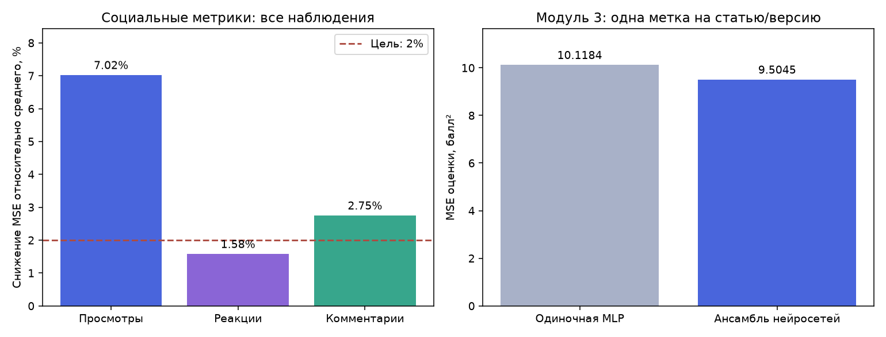
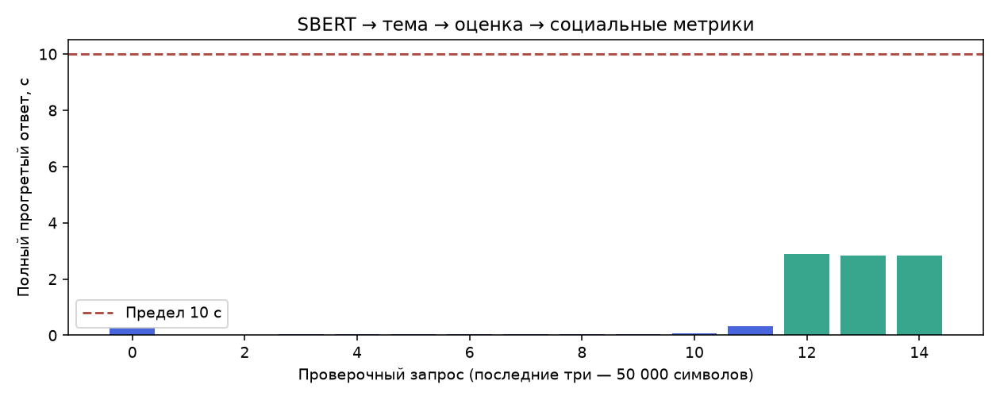

# Расширенные входы, история наблюдений и полная проверка — 12.11.2026

Исторический отчёт. Реализация повторных замеров удалена. [Текущая версия и парная проверка](../2026-11-12-unified-inputs/README.md).

Проверены все **12,131 наблюдений** / **11,740 статей**; каналов — **171**. Пять внешних групповых разбиений; каждая строка получает ровно один прогноз вне обучения. Редакции и повторы статьи не пересекают разбиения.

Рабочая цепочка использует эмбеддинг полного текста, дату публикации и горизонт. Модуль 3 получает только текст и тему. История БД сохраняет фактические аудитории, время получения и версии текста.

| Метрика | MSE среднего канала | MSE модели | Снижение MSE | Цель 2% |
| --- | ---: | ---: | ---: | --- |
| Просмотры | 15001178.84 | 13947943.06 | 7.021% | да |
| Реакции | 2200766.89 | 2166058.42 | 1.577% | нет |
| Комментарии | 2350.96 | 2286.33 | 2.749% | да |

При одном выбранном замере на статью/версию (11740 строк): снижение MSE просмотров **5.925%**, реакций **1.555%**, комментариев **2.981%**. Цель реакций 2% не достигнута и в этой проверке.

Модуль 3: MSE **10.118391 → 9.504512**, снижение **6.07%**. Одна метка на версию статьи, ближайшая к семи дням.

Прогретый полный ответ с SBERT: максимум **2.899 с**. Загрузка и первый запрос исключены из лимита; LLM в измерение не входит. Время обучения не участвовало в выборе.





## Проверка и ограничения

БД содержит 10613 фактических наблюдений. Дополнительно сохранены 1527 старых исследовательских записей с общим временем сбора; они не вставлялись в БД как фактические замеры. Исключено по возрасту: 9.

На 12112 наблюдениях канал есть в обучающей части. Для остальных 19 использован глобальный обучающий ориентир. Отдельные результаты для известных каналов и для одного замера на статью находятся в summary.json.

Среднее канала — арифметическое среднее исходных количеств по каноническим обучающим статьям. Новая проверка использует изменившийся корпус и фактические даты; её проценты нельзя напрямую вычитать из результатов 11 ноября. Исходные цели не ограничивались и необычные счётчики не удалялись.

Большинство статей пока имеет один возрастной замер. Наличие горизонта не доказывает точную калибровку на каждый день. Нужна проверка будущих дат. Корпус неоднократно использовался для разработки: эти результаты не являются новым независимым контролем.

95% интервалы улучшения получены повторной выборкой целых каналов и сохранены в summary.json. Условие 2% оценивается отдельно для каждого счётчика; невыполненные цели остаются открытыми.

## Воспроизведение

```powershell
python -m model_tests.validate_live_rich_pipeline --output model_tests/results/live_rich_20261112 --stage
python -m model_tests.refine_history_reactions --study model_tests/results/live_rich_20261112 --output model_tests/results/live_reactions_20261112 --stage
```

Локальные снимки и матрицы не включены в GitHub. Для проверки собственной БД выполните сбор, затем задайте новый каталог и `--database-only`: без закрытых исследовательских снимков этот режим используется автоматически. Реальные тексты, ID статей, векторы и разбиения не входят в публичный отчёт.

Окончательный подбор реакций дополнительно меняет обучающий квантиль (0.85–1). Код: `model_tests.refine_reaction_caps`; рабочая процедура: `src.social_metrics_prediction.reaction_training`. `source_parity.json` подтверждает точное совпадение всех 12 131 прогнозов. Команда проверки: `python -m model_tests.verify_reaction_training --study model_tests/results/live_rich_20261112 --research model_tests/results/live_reaction_caps_20261112`.
