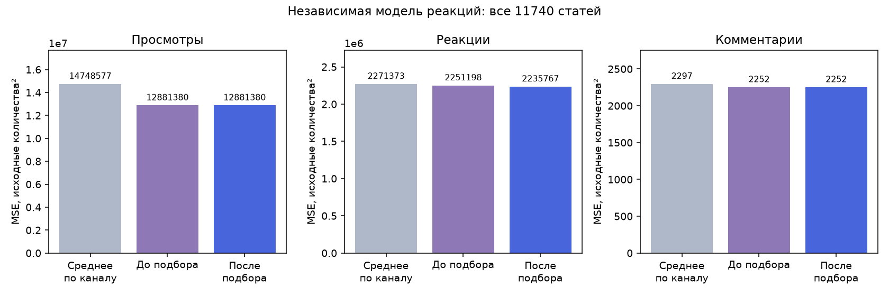

# Подбор отдельной модели реакций — 12.11.2026

Выигрыш реакций относительно среднего по каналу вырос с **0.888%** до **1.568%** по исходной MSE. Порог 1% пройден на всей выборке. Модели просмотров, комментариев и текстовая сеть сохранены.

| Метрика | MSE среднего | MSE до подбора | MSE после | Снижение MSE к среднему |
| --- | ---: | ---: | ---: | ---: |
| Просмотры | 14748576.57 | 12881379.95 | 12881379.95 | 12.660% |
| Реакции | 2271372.63 | 2251197.52 | 2235766.64 | 1.568% |
| Комментарии | 2296.83 | 2252.47 | 2252.47 | 1.932% |

## Проверка

Использованы те же **11740 уникальных статей**, пять внешних групповых разбиений и прогнозы текстовой сети, что в [предыдущем сравнении](../2026-11-12-unified-inputs/README.md). Каждая статья проверена ровно один раз вне обучающей группы. Точные нормализованные повторы текста не пересекаются между частями. Веса других двух моделей не менялись; их прогнозы на всех строках совпадают.

В каждой внешней обучающей части параметры реакций выбирались на трёх внутренних групповых разбиениях. Проверены 3000 сочетаний числа соседей, температуры, квантиля, силы поправки и веса контекста. Внешние целевые значения в подбор не передавались. В проверке сохранены исходные счётчики, включая редкие всплески; ограничиваются только обучающие значения при построении модели.

Все три независимые модели получают одну полную матрицу: вектор текста, тему, прогнозную оценку популярности, ресурс, тип источника, аудиторию, дату публикации и срок прогноза. Веса контекста положительны. Другие фактические счётчики не являются входами модели реакций. Для каждой статьи используется одна текущая запись; накопления повторных замеров нет.

Максимальный прогретый полный ответ с SBERT: **3.682 с**. Загрузка моделей и первый запрос в лимит не входят. Время обучения не использовалось при выборе.

## Итоговая конфигурация реакций

```json
{
  "family": "neighbours",
  "same_resource": true,
  "context_weight": 0.003,
  "quantile": 0.9,
  "neighbours": 5,
  "temperature": 0.25,
  "strength": 1.25
}
```



## Воспроизведение

```powershell
python -m model_tests.validate_unified_metrics --database-only --output model_tests/results/my_validation
python -m src.social_metrics_prediction train
```

Локальная фиксированная выборка и промежуточные модели не включены в GitHub. Исследовательский сценарий `refine_shared_reactions.py` позволяет повторить парное сравнение по сохранённым внешним разбиениям. Рабочее обучение использует ту же процедуру подбора параметров реакций.

Корпус ранее использовался в разработке; это результат повторной групповой проверки, а не независимое подтверждение на будущих датах. 1527 дополнительных статей имеют общее время сбора партии. Глобальная MSE чувствительна к редким большим значениям реакций. Качество на каждом канале и дне отдельно не гарантируется.
