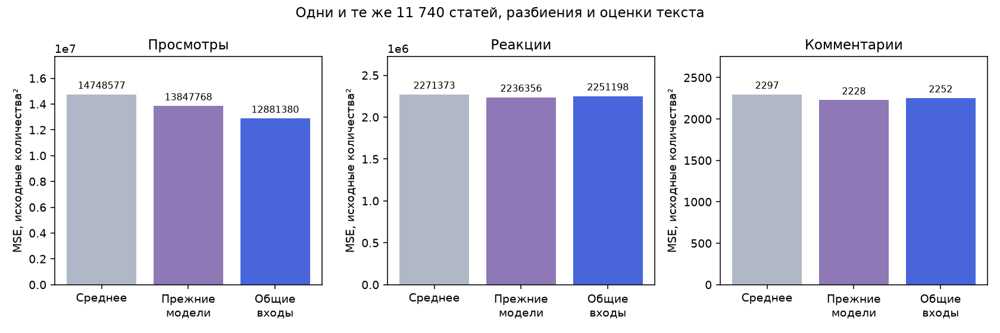
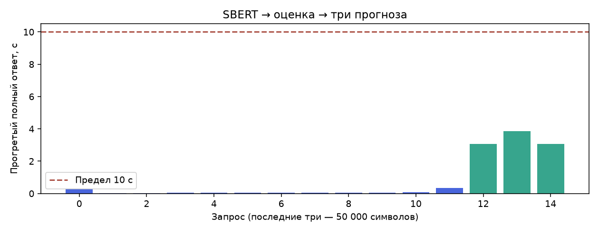

# Общие входы и одна запись на статью — 12.11.2026

Этот отчёт описывает этап внедрения общих входов. Позже отдельно улучшена модель реакций: её выигрыш относительно среднего канала повышен с 0.89% до 1.57%, остальные модели сохранены. [Текущий результат](../2026-11-12-reactions/README.md).

Просмотры, реакции и комментарии получают одну и ту же полную матрицу: вектор текста, тема, предсказанная оценка популярности, ресурс, тип источника, аудитория, время публикации и срок прогноза. Различаются обученные параметры моделей.

В рабочей БД удалена таблица истории замеров. В пяти исходных таблицах для каждой статьи остаётся актуальное состояние. Повторный сбор обновляет метрики по ID статьи. Сохраняется только время получения последнего набора счётчиков.

Проверены все **11740 уникальных статей**; прежние и новые модели обучались на одинаковых частях, получали одинаковые оценки текста и проверялись на одинаковых строках. Пять внешних групповых разбиений, три внутренних разбиения текстовой сети, два разбиения подбора социальных моделей. Целевые счётчики не изменялись.

| Метрика | MSE среднего | MSE прежних моделей | MSE общих входов | Изменение MSE к прежним |
| --- | ---: | ---: | ---: | ---: |
| Просмотры | 14748576.57 | 13847767.57 | 12881379.95 | -6.979% |
| Реакции | 2271372.63 | 2236356.10 | 2251197.52 | +0.664% |
| Комментарии | 2296.83 | 2227.91 | 2252.47 | +1.102% |

Отрицательное изменение означает уменьшение ошибки. Просмотры улучшились относительно прежних моделей; реакции и комментарии немного ухудшились. Изменение набора входов не объявляется улучшением всех метрик.

| Метрика | Снижение MSE относительно среднего | Цель 2% |
| --- | ---: | --- |
| Просмотры | 12.660% | достигнута |
| Реакции | 0.888% | не достигнута |
| Комментарии | 1.932% | не достигнута |

MSE оценки по тексту: **9.511103**. Текстовая сеть получает только текст и тему; метка каждой статьи берётся из последнего набора её метрик.

Максимум прогретого полного ответа: **3.865 с**, включая SBERT. Загрузка моделей и первый запрос исключены из лимита. Время обучения не использовалось как критерий выбора.





## Воспроизведение

```powershell
python -m src.database init-db
python -m model_tests.validate_unified_metrics --database-only --output model_tests/results/my_unique_validation
python -m src.social_metrics_prediction train
```

Перед заменой собственных весов нужно закончить полную проверку. Исследовательские снимки не включены в GitHub; новая проверка использует текущие статьи собственной БД. Рабочий код не читает историю замеров, не выбирает замер по близости к выбранному возрасту и не хранит прежние версии текста.

Для текущего сравнения из локального корпуса заранее оставлена только последняя запись каждого ID статьи. 391 более ранняя запись исключена до обучения. 1527 старых дополнительных статей имеют общее время сбора партии. Корпус ранее использовался в разработке: необходим отдельный контроль будущих дат. Наличие срока прогноза не гарантирует точную калибровку по каждому дню.
